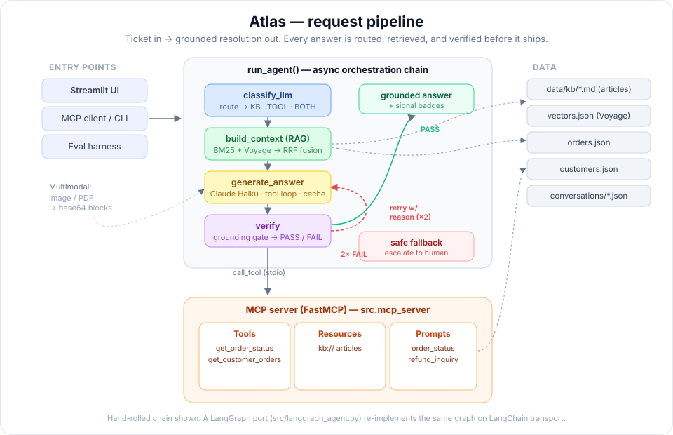
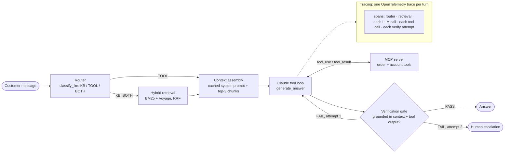

# Atlas — Northwind Support Agent

[](https://github.com/jayeshkhattar/northwind-atlas/actions/workflows/ci.yml)
[](EVALS.md)
[](LICENSE)

A customer-support agent for a fictional D2C coffee-gear brand ("Northwind"). Atlas
resolves tickets end to end: it answers from a knowledge base, calls real tools
(order lookup, account history), reads uploaded screenshots and receipts, and
**verifies every answer against its sources before replying** — falling back to a
human escalation when it can't ground the response.

Built on the raw Anthropic SDK plus a **Model Context Protocol (MCP)** server, with a
hand-rolled orchestration chain and a parallel [LangGraph](src/langgraph_agent.py) port
of the same graph.

<p align="center">
  
</p>

---

## What it does

- **Routing** — an LLM classifier tags each ticket `KB`, `TOOL`, or `BOTH`, so
  documentation lookup and live tool calls fire only when needed.
- **Hybrid RAG** — BM25 lexical search + Voyage AI semantic embeddings, combined with
  Reciprocal Rank Fusion over a Markdown knowledge base.
- **Tool use over MCP** — order and account tools run in an MCP server (`FastMCP`); the
  agent is the MCP client and calls them over stdio.
- **Grounding verification** — a verifier node judges each answer against the retrieved
  context and tool results. On failure it retries with the reason injected (max 2), then
  returns a safe human-escalation fallback rather than guessing.
- **Multimodal intake** — customers can attach a screenshot (PNG/JPG) or a receipt (PDF);
  files are turned into base64 content blocks.
- **Prompt caching** — the stable system prompt is cached (ephemeral) ahead of the
  variable context, cutting cost on repeat turns.
- **Persistence** — conversations are stored as JSON and survive restarts.
- **Evals** — a small harness with code-based and model-based grading gates every change.

## Interfaces

| Entry point | Command | Purpose |
|---|---|---|
| **Streamlit UI** | `streamlit run src/ui.py` | Chat demo with file upload and live signal badges |
| **CLI** | `python -m src.main` | One-shot agent run over an MCP session |
| **Tests** | `make test` | 50 offline unit tests (no keys, under 2 s) |
| **Evals** | `make evals` / `make evals-live` | Graded eval suite: replayed offline, or against the real API |
| **Trace** | `python -m scripts.trace_dump "<query>"` | Print one turn's trace as a span tree |

The Streamlit UI surfaces the agent's internal decisions per response as badges —
**route** (KB/TOOL/BOTH), **verify** (pass/fail + attempt count), **cache** (tokens
written/read), and which **tools** fired — so the reasoning is visible, not buried in
stdout.

---

## Quickstart

Requires Python 3.12+. Run everything **from the repo root** (data paths and the MCP
server launch are relative).

```bash
# 1. install
python -m venv venv && source venv/bin/activate
pip install -r requirements.txt

# 2. configure keys (create .env in the repo root)
cat > .env <<'EOF'
ANTHROPIC_API_KEY=sk-ant-...
VOYAGE_API_KEY=pa-...
EOF

# 3. run the demo UI
streamlit run src/ui.py
```

Then try, in the UI:

- `how long do refunds take?` — KB route, grounded from the docs
- `what's the status of order NW-10001?` — TOOL route, live order lookup
- attach any PNG/JPG screenshot or a PDF receipt and ask about it — multimodal path
- `do refunds take 47 business days and require a blood sample?` — verify fails → escalation fallback

To check the install without any API keys:

```bash
pip install -r requirements-dev.txt
make test    # unit tests, fully offline
make evals   # replays the recorded eval run and prints the pass rate (once a run is recorded)
```

---

## Architecture



## How it works

`run_agent()` in [src/agent.py](src/agent.py) is the orchestration chain:

```
classify_llm  →  build_context (RAG)  →  generate_answer (tool loop)  →  verify
                                                    ▲                        │
                                                    └──── retry w/ reason ◀──┘  (×2)
                                                                             │
                                                              PASS → answer  │  2×FAIL → escalate
```

- **classify_llm** returns the route; retrieval is skipped for pure `TOOL` tickets.
- **build_context** ([src/search.py](src/search.py)) fuses BM25
  ([src/retrieval.py](src/retrieval.py)) and semantic hits
  ([src/embeddings.py](src/embeddings.py)) via RRF.
- **generate_answer** runs the Claude tool loop; tool calls are dispatched to the MCP
  server ([src/mcp_server.py](src/mcp_server.py)) over stdio.
- **verify** is a grounding gate — it compares the answer to the actual context and tool
  outputs and returns PASS or FAIL-with-reason.

The MCP server exposes all three MCP primitives: **tools** (`get_order_status`,
`get_customer_orders`), **resources** (`kb://` knowledge-base articles), and **prompts**
(templated support inquiries).

## Tracing

Each turn is one OpenTelemetry trace with spans for the router call, retrieval (BM25 scores,
semantic hits, fused RRF ranks), every model call (tokens, cache hits, latency), every MCP
tool call (input, output size, errors) and each verification attempt (verdict, reason,
escalation). Tracing is off by default. Set `ATLAS_TRACING=console`, `otlp` or `langfuse` to
turn it on. See [docs/tracing.md](docs/tracing.md) for the span layout and a real trace.

## Evals, tests and standards

- [EVALS.md](EVALS.md): the eval cases and how they're graded. The pass rate and latency
  go there from the first recorded run; none has been recorded yet.
- [tests/](tests): offline unit tests for routing, retrieval, the verification gate, MCP
  tool schemas, context assembly and the tool loop. Writing them turned up three real bugs,
  each fixed in its own commit.
- [STANDARDS.md](STANDARDS.md): how to add a tool or an eval case, what has to pass before
  merge, how prompts are versioned, and how to turn a production trace into a repro.

## Design decisions

**Raw SDK first, framework second.** The main chain calls the Anthropic SDK directly, so
every model call, retry and tool dispatch is a plain function you can read, test with a fake
client, and wrap in a span. The [LangGraph port](src/langgraph_agent.py) re-implements the
same graph to compare the two. LangGraph forces clean node boundaries, and retry becomes a
single conditional edge instead of logic spread across generate and verify. The tool loop,
though, still runs imperatively inside one node. Notes in [LANGGRAPH.md](LANGGRAPH.md).
Building it by hand first meant I knew exactly what the framework was abstracting.

**Reciprocal Rank Fusion.** BM25 and cosine similarity produce scores on different scales,
so you can't just add them. RRF only uses ranks (`1 / (60 + rank)`), so there's nothing to
tune or normalize, and a chunk that both indexes rank highly comes out on top. BM25 catches
exact terms (order states, product names). The embeddings catch paraphrases. "How do I get
my money back" scores zero on BM25 but finds the refunds article semantically (there's a
test for that).

**A verification gate instead of trusting the model.** The system prompt already says "only
answer from the documentation", and the model mostly follows it. "Mostly" isn't good enough
for refund timelines and contact details. A second, narrow call that only asks whether this
answer is supported by this context catches the cases the instructions miss, and its reason
is fed back into the retry.

**Human escalation as the floor.** After two failed attempts the agent stops and hands
off, using a fixed message. A wrong answer about money or warranties costs more than a
handoff, so the failure mode is "slower", not "wrong". Escalation rate is tracked in every
eval report so it can't quietly creep up.

## Project structure

```
src/
  agent.py            orchestration chain (classify → retrieve → generate → verify);
                      the verify gate, retry and escalation fallback are in run_agent()
  ui.py               Streamlit demo UI (chat, uploads, signal badges)
  retrieval.py        BM25 lexical search + KB chunking
  embeddings.py       Voyage AI semantic embeddings (cached to data/vectors.json)
  search.py           multi-index RRF fusion
  tools.py            order / account tool functions + schemas
  mcp_server.py       FastMCP server: tools, resources, prompts
  mcp_client.py       MCP client demo (lists tools/resources/prompts)
  multimodal.py       image / PDF → base64 content blocks
  conversations.py    JSON conversation persistence
  tracing.py          OpenTelemetry setup + span helpers (no-op unless ATLAS_TRACING is set)
  evals.py            eval harness CLI: live / record / replay, threshold gate
  langgraph_agent.py  parallel LangGraph port of the same chain
tests/                offline pytest suite (fakes for Anthropic + Voyage, real MCP server in-memory)
evals/
  cases.json          eval cases
  cassette.json       recorded model/embedding responses for offline replay
scripts/
  generate_data.py    builds the synthetic orders/customers
  trace_dump.py       run one turn and print its span tree
data/
  kb/*.md             knowledge-base articles
  orders.json         50 synthetic orders (scripts/generate_data.py)
  customers.json      synthetic customers (customerN@example.com)
  vectors.json        cached Voyage embeddings, aligned to load_kb() order
  conversations/      chats saved by the UI at runtime (gitignored, not in the repo)
  uploads/            files attached in the UI (gitignored, not in the repo)
assets/
  atlas_pipeline.svg       request pipeline (above)
  atlas_architectures.svg  chain vs. workflow vs. agent comparison
```

## Tech stack

Anthropic Claude (Haiku, Sonnet as eval grader) · Model Context Protocol / FastMCP ·
Voyage AI embeddings · `rank-bm25` · NumPy · OpenTelemetry (Langfuse via OTLP) · pytest ·
ruff · GitHub Actions · Streamlit · LangGraph (parallel port) · Docker · Kubernetes.

---

## About this project

Atlas is a portfolio capstone for building agentic systems on the Claude API. It's
deliberately built on the **raw SDK** — hand-rolled routing, tool loop, RAG fusion, and
grounding checks — rather than leaning on a framework, so each layer is explicit and
inspectable. The [LangGraph port](src/langgraph_agent.py) re-implements the identical
graph on LangChain transport as a side-by-side comparison of framework vs. hand-rolled.
See [PROJECT.md](PROJECT.md) for the full scope and [PROGRESS.md](PROGRESS.md) for build
history.

All data in this repo is synthetic: the customers, orders and knowledge base describe a
fictional company. Conversations and uploads are created locally at runtime and are not
committed.

## License

MIT. See [LICENSE](LICENSE).
